# Real Estate MLOps · Kubernetes, Airflow y MLflow

**Grupo 6:** Kevin Bueno · Juan Camilo Martínez · Jorge Andrés Gil

**Video presentacion proyecto final:**

[](https://youtu.be/JB0RKHSxoBg)

Plataforma MLOps de extremo a extremo para estimar el precio de propiedades inmobiliarias. Airflow consume la API de datos del curso lote a lote (grupo 6), valida cada lote, lo guarda en RAW y CLEAN, decide con reglas explícitas si reentrena y registra el candidato en MLflow, donde solo recibe el alias `production` si supera al modelo productivo; los artefactos viven en RustFS (almacén S3), una API FastAPI sirve `models:/real_estate@production` en `POST /predict` y un frontend Streamlit lo consulta. Todo corre en Kubernetes (OrbStack) con autoescalado de la API, incluidos Prometheus, Grafana y Jaeger, que la observan; Locust (Server B) genera la carga desde otra máquina.


## Ruta rápida

1. Instalar en el clúster, una sola vez, los CRDs de Gateway API, Traefik como controlador y metrics-server (OrbStack no trae ninguno; el HPA necesita el último). Los CRDs van primero porque el `GatewayClass` de Traefik es uno de ellos:

   ```bash
   kubectl apply -f https://github.com/kubernetes-sigs/gateway-api/releases/download/v1.6.3/standard-install.yaml
   kubectl apply -k infra/k8s/traefik
   kubectl apply -f https://github.com/kubernetes-sigs/metrics-server/releases/download/v0.9.1/components.yaml
   ```

   Si el clúster ya tiene otro controlador que publique un LoadBalancer en el puerto 80, hay que desinstalarlo antes: Traefik usa ese mismo puerto.

2. Desplegar Server A completo (usa las imágenes publicadas en Docker Hub, no hace falta construir nada):

   ```bash
   kubectl create namespace real-estate
   bash infra/k8s/scripts/render-env.sh   # .env -> ConfigMaps (infra/k8s/settings) y Secrets (infra/k8s/generated)
   kubectl apply -k infra/k8s/generated   # los Secrets no están en git
   kubectl apply -k infra/k8s             # o registrar la Application de Argo CD, ver más abajo
   kubectl -n real-estate get pods        # esperar Running / Completed; el primer arranque tarda unos minutos
   ```

3. Activar el DAG `real_estate_incremental_training` en <http://airflow.k8s.orb.local> (`airflow` / `airflow`). Se crea pausado; al activarlo el scheduler lanza la primera corrida, que carga el primer lote, entrena y deja el modelo `real_estate` con el alias `production` en MLflow (alrededor de un minuto):

   ```bash
   kubectl -n real-estate exec deploy/airflow -c scheduler -- airflow dags unpause real_estate_incremental_training
   ```

4. Revisar los runs en <http://mlflow.k8s.orb.local> y la versión servida en <http://api.k8s.orb.local/model-info> (`"status": "ready"`; la API recarga el alias sola cada 60 s).
5. Estimar un precio desde el frontend <http://frontend.k8s.orb.local> (botón **Cargar ejemplo** y **Estimar precio**) o por API. El cuerpo lleva en `features` los 10 campos del contrato de [docs/data-contract.md](docs/data-contract.md); todos son obligatorios y admiten `null`:

   ```bash
   curl -s -X POST http://api.k8s.orb.local/predict -H 'Content-Type: application/json' -d '{
     "features": {
       "brokered_by": "101", "status": "for_sale", "bed": 3, "bath": 2, "acre_lot": 0.25,
       "city": "Austin", "state": "Texas", "zip_code": "78701",
       "house_size": 1800.0, "prev_sold_date": "2018-06-15"
     }
   }'
   ```

   Forma de la respuesta (`prediction` es el precio estimado en USD; los valores son ilustrativos):

   ```json
   {
     "request_id": "8a5dbc13-bb70-4301-bb2e-b6ed8021fa0b",
     "prediction": 465000.0,
     "model": { "name": "real_estate", "version": "1", "alias": "production" },
     "processing_time_ms": 12.5
   }
   ```

   La documentación interactiva está en <http://api.k8s.orb.local/docs>.

> Mientras no exista un modelo con el alias `production`, `/predict` responde `503` y `/health` responde `200` con `model_loaded=false`. No hace falta reiniciar la API: consulta el registro cada `MODEL_REFRESH_SECONDS` y `POST /model/reload` fuerza la carga.

## Arquitectura

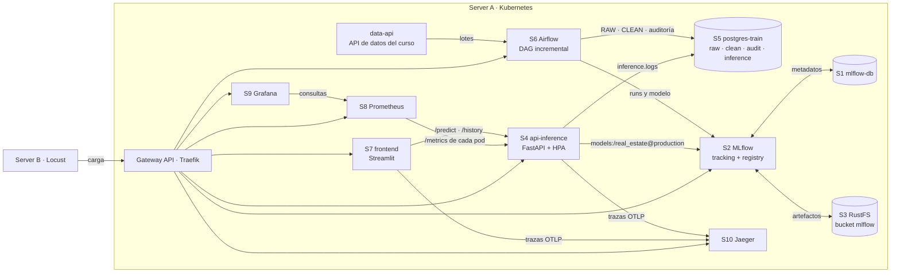

Server B (Locust) corre en otra máquina y llega al clúster por una red Tailscale, para que el generador de carga no compita por CPU con la API. En OrbStack todo Server A queda en el namespace `real-estate` y el Gateway (Gateway API, servido por Traefik) resuelve los hosts `*.k8s.orb.local` desde el Mac.

| Servicio | URL | Credenciales | Rol |
|----------|-----|--------------|-----|
| `mlflow-db` (S1) | solo red interna | `mlflow` / `mlflow` | Backend store de MLflow |
| `mlflow` (S2) | <http://mlflow.k8s.orb.local> | sin autenticación | Tracking server y Model Registry; sirve los artefactos por proxy hacia RustFS |
| `rustfs` (S3) | consola `http://rustfs.real-estate.svc.cluster.local:9001/rustfs/console/` | `RUSTFS_ACCESS_KEY` / `RUSTFS_SECRET_KEY` de `.env` | Almacén de artefactos, bucket `mlflow` (lo crea el Job `rustfs-init`) |
| `api-inference` (S4) | <http://api.k8s.orb.local> | sin autenticación | Sirve `models:/real_estate@production`; HPA de 1 a 20 pods al 70 % de CPU |
| `postgres-train` (S5) | solo red interna | `app` / `app`, base `real_estate` | Esquemas `raw`, `clean`, `audit` e `inference` (migraciones por el Job `train-db-migrate`) |
| `airflow` (S6) | <http://airflow.k8s.orb.local> | `airflow` / `airflow` | api-server, scheduler, dag-processor y triggerer en un pod; metadatos en `airflow-db` |
| `data-api` | solo red interna | — | API de datos del curso (imagen del instructor); entrega los lotes al DAG |
| `frontend` (S7) | <http://frontend.k8s.orb.local> | — | Formulario con los 10 campos del contrato e historial por lote; solo habla con la API |
| Prometheus (S8) · Grafana (S9) | <http://prometheus.k8s.orb.local> · <http://grafana.k8s.orb.local> | Prometheus sin autenticación; Grafana `GRAFANA_ADMIN_USER` / `GRAFANA_ADMIN_PASSWORD` de `.env` | Métricas de cada pod de la API y dashboard **Real Estate · Inference API**, aprovisionado desde ConfigMaps |
| Jaeger (S10) | <http://jaeger.k8s.orb.local> | sin autenticación | Trazas de cada inferencia, del frontend a la escritura del log; en memoria, se pierden al reiniciar el pod |
| Locust (Server B) | <http://localhost:8089> | — | `infra/load-testing`, perfil `loadtest` de compose; fuera del clúster a propósito |

## Infraestructura en Kubernetes

Todo Server A se despliega con `kubectl apply -k infra/k8s` en el namespace `real-estate`. Cada componente tiene su carpeta en `infra/k8s/base/<componente>` con el workload, su Service y, cuando aplica, PVC y Jobs; los Secrets y los ConfigMaps que dependen de `.env` se generan con `infra/k8s/scripts/render-env.sh`: esos ConfigMaps quedan en `infra/k8s/settings` (versionado) y los Secrets en `infra/k8s/generated` (ignorado por git, se aplica aparte con `kubectl apply -k infra/k8s/generated`). Los ConfigMaps con valores fijos (`mlflow-db-env`, `airflow-db-env`, `postgres-train-env`, `pipeline-config`) se declaran en `base/`, y `train-db-migrations` se renderiza con `render-migrations.sh`. La imagen de los tres componentes propios se fija en `infra/k8s/kustomization.yaml`.

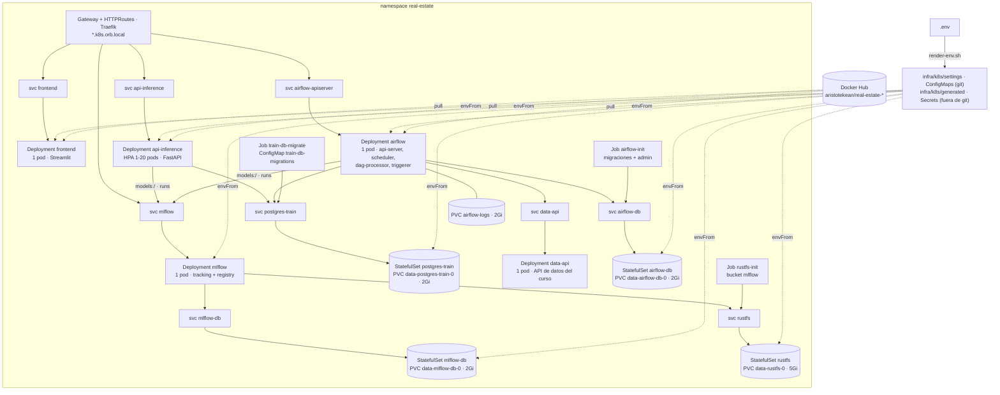

Las bases de datos y RustFS son `StatefulSet` con una réplica: el pod tiene identidad estable (`postgres-train-0`), su PVC sale de `volumeClaimTemplates` y sobrevive al pod, y una actualización termina el pod viejo antes de crear el nuevo, así nunca hay dos instancias escribiendo el mismo volumen. Cada uno tiene además un Service headless (`<nombre>-headless`) que exige el StatefulSet; los clientes siguen usando el Service normal. Los componentes sin estado son `Deployment`; la API escala con un HPA y su spool de logs de inferencia vive en un `emptyDir` para poder correr varias réplicas.

| Componente | Workload | ConfigMap | Secret | Persistencia | Probes | requests → limits |
|------------|----------|-----------|--------|--------------|--------|-------------------|
| `mlflow-db` | StatefulSet | `mlflow-db-env` | `mlflow-db-credentials` | `data-mlflow-db-0` (2Gi) | readiness, liveness (`pg_isready`) | 100m/256Mi → 500m/512Mi |
| `airflow-db` | StatefulSet | `airflow-db-env` | `airflow-db-credentials` | `data-airflow-db-0` (2Gi) | readiness, liveness (`pg_isready`) | 100m/256Mi → 500m/512Mi |
| `postgres-train` | StatefulSet + Job `train-db-migrate` | `postgres-train-env`, `train-db-migrations` | `postgres-train-credentials` | `data-postgres-train-0` (2Gi) | readiness, liveness (`pg_isready`) | 100m/256Mi → 500m/512Mi |
| `rustfs` | StatefulSet + Job `rustfs-init` | — | `rustfs-credentials` | `data-rustfs-0` (5Gi) | readiness, liveness (`/health/ready`, `/health/live`) | 100m/256Mi → 500m/1Gi |
| `mlflow` | Deployment | `mlflow-server-env`, `mlflow-client-env` | `mlflow-db-credentials`, `rustfs-credentials` | sin estado (Postgres + RustFS) | startup, readiness, liveness (`/health`) | 250m/768Mi → 1/2Gi |
| `api-inference` | Deployment + HPA | `api-inference-env`, `mlflow-client-env` | `postgres-train-credentials`, `rustfs-credentials` | `emptyDir` spool (256Mi) | startup y liveness (`/live`), readiness (`/ready`) | 250m/512Mi → 1/1Gi |
| `data-api` | Deployment (imagen del curso, fijada por digest) | — | — | sin estado (el contador de lotes vive en memoria) | startup, readiness, liveness (`/health`) | 250m/768Mi → 1/2Gi |
| `frontend` | Deployment | `frontend-env` | ninguno (no maneja credenciales) | sin estado | startup, readiness, liveness | 100m/256Mi → 500m/512Mi |
| `airflow` | Deployment + Job `airflow-init` | `airflow-env`, `pipeline-config`, `mlflow-client-env` | `airflow-secrets`, `airflow-db-credentials`, `airflow-admin-user`, `rustfs-credentials`, `postgres-train-credentials` | `airflow-logs` (2Gi, logs de tareas) | api-server: startup, readiness, liveness; scheduler, dag-processor y triggerer: liveness | api-server 250m/512Mi → 500m/1Gi · scheduler 500m/1.5Gi → 2/4Gi · dag-processor 150m/256Mi → 250m/768Mi · triggerer 100m/256Mi → 250m/768Mi |

Los init containers de espera (`pg_isready`, `rc`, `airflow db check-migrations`) y los Jobs también declaran `requests` y `limits`; `bash infra/k8s/scripts/check.sh` renderiza `.env`, valida que los kustomize construyan y comprueba que el ConfigMap de migraciones esté al día antes de commitear.

### CI/CD con GitHub Actions y Argo CD

El workflow `.github/workflows/ci-cd-unit-tests-dockerhub.yml` se dispara con cambios en `services/`, `ml/`, `scripts/`, `.dockerignore` y el propio workflow (pushes a `main` y `feature/**`, y pull requests hacia `main`):

1. `unit-tests` corre las tres suites (`api-inference`, `frontend`, `real-estate-model`).
2. `publish-dockerhub`, solo en pushes a `main` y si las pruebas pasan, construye y publica las tres imágenes `real-estate-*` para `linux/amd64` y `linux/arm64` con las etiquetas `latest` y el SHA del commit.
3. `update-manifests` escribe ese SHA en los tres `newTag` (y el usuario de Docker Hub en los `newName`) de `infra/k8s/kustomization.yaml` y hace commit en `main`.
4. Argo CD detecta el commit y despliega las imágenes nuevas.

Ese commit solo toca `infra/**`, que está fuera de los `paths` del workflow, y se publica con `GITHUB_TOKEN`, por lo que no vuelve a disparar el workflow. Para habilitar la publicación, configura los secretos del repositorio `DOCKERHUB_USERNAME` y `DOCKERHUB_TOKEN`.

`infra/argocd/application.yaml` declara una `Application` que mantiene el clúster sincronizado con `infra/k8s` en `main` (sincronización automática, con `prune` y `selfHeal`). Puesta en marcha, una sola vez:

```bash
# 1. Instalar Argo CD (consulta la guía oficial para tu versión)
kubectl create namespace argocd
kubectl apply -n argocd --server-side \
  -f https://raw.githubusercontent.com/argoproj/argo-cd/stable/manifests/install.yaml

# 2. Crear los Secrets (Argo CD no los gestiona: no están en git)
kubectl create namespace real-estate
bash infra/k8s/scripts/render-env.sh
kubectl apply -k infra/k8s/generated

# 3. Registrar la aplicación
kubectl apply -f infra/argocd/application.yaml
```

- Los Jobs (`train-db-migrate`, `rustfs-init`, `airflow-init`) son hooks `Sync`: Argo CD los borra y recrea en cada sincronización, así que se vuelven a ejecutar (son idempotentes).
- Los Secrets tienen nombre fijo. Tras cambiar una credencial en `.env`: renderizar, `kubectl apply -k infra/k8s/generated` y `kubectl -n real-estate rollout restart deployment,statefulset`.
- Un cambio de configuración no sensible en `.env` llega al clúster por git: renderizar y commitear `infra/k8s/settings`.
- Si el repositorio es privado, registra sus credenciales en Argo CD; y el job `update-manifests` necesita poder hacer push a `main` (una regla de protección de rama que lo impida hará fallar el paso).

## Datos en PostgreSQL

`infra/database/migrations` crea los esquemas en `postgres-train`, una base distinta de la de metadatos de MLflow (`mlflow-db`). En Kubernetes los aplica el Job `train-db-migrate` (ConfigMap generado con `infra/k8s/scripts/render-migrations.sh`); en compose, el servicio del mismo nombre.

| Esquema | Contenido |
|---------|-----------|
| `raw` | `raw.api_requests`: cada petición a la API de datos y su resultado (lote nuevo, reanudado, duplicado, vacío, fin de datos, error). `raw.batches`: cada respuesta de la API de datos tal cual (gzip + SHA-256), con número de lote, esquema recibido y estado. `raw.records`: cada registro sin modificar (JSONB), con estado `loaded` / `validated` / `rejected` y su motivo |
| `clean` | `clean.records`: registros tipados listos para entrenar, con trazabilidad a RAW (`raw_record_id`, `batch_id`), motivo de exclusión (`exclusion_reason`, outliers) y partición `data_split` (`train` / `validation` / `test`) por propiedad |
| `audit` | `audit.batch_history`: una fila por lote con validaciones, drift, categorías nuevas, decisión de entrenamiento y su motivo, IDs de MLflow, métricas y promoción. La vista `audit.batch_history_summary` es el historial que muestra Streamlit |
| `inference` | `inference.logs`: una fila por petición a `/predict`. `inference.feedback`: el precio real observado de una predicción ya registrada. `inference.training_examples`: vista que une las predicciones exitosas con su feedback |

## Entrenamiento y registro del modelo

Los datos llegan de la API del curso (`cristiandiaz13/mlops-puj:data-api-pf-v2`, Deployment `data-api`, **grupo 6**, 6 lotes). Cada corrida del DAG `real_estate_incremental_training` pide **un** lote, lo guarda en RAW, lo valida (esquema, calidad, categorías nuevas, drift), lo procesa a CLEAN y decide con reglas explícitas si entrena. Si entrena, compara el candidato contra el modelo productivo y solo mueve el alias `production` si mejora según la regla de promoción.

El diseño completo, las reglas de decisión y de promoción y la tabla de parámetros ajustables están en **[docs/pipeline.md](docs/pipeline.md)**. Los umbrales viven en el ConfigMap `pipeline-config` de [infra/k8s/base/airflow/kustomization.yaml](infra/k8s/base/airflow/kustomization.yaml).

| Qué se registra | Detalle |
|-----------------|---------|
| Candidatos | Ridge e HistGradientBoosting sobre `log1p(price)`, como runs anidados del experimento `real-estate-pricing` |
| Métrica principal | MAE de validación (USD, interpretable), con RMSE como métrica de control |
| Promoción | Se promueve si el MAE mejora ≥ 3 % y el RMSE no empeora más de 1 % frente al productivo, ambos evaluados sobre la misma validación |
| Trazabilidad | Lotes usados, commit (`GIT_COMMIT`), parámetros, métricas train/validation/test, gráficos, importancia por permutación y motivo del entrenamiento |

## Estructura del repositorio

```text
.
├── .claude/                          # Skill de pre-evaluación y hook de Claude Code
├── .env.example                      # Plantilla de variables para compose y Kubernetes
├── .github/workflows/                # CI: pruebas, publicación en Docker Hub y pin de imágenes en infra/k8s
├── CLAUDE.md                         # Guía del repositorio para Claude Code
├── docker-compose.yml                # Stack completo en compose (incluye airflow, locust y monitoring)
├── services/
│   ├── api-inference/                # S4 FastAPI: /predict (y su feedback), /health, /model-info, /model/reload, /history, /metrics
│   ├── frontend/                     # S7 Streamlit
│   └── airflow/                      # S6 imagen y DAG real_estate_incremental_training
├── ml/real_estate_model/             # Paquete compartido: contrato, features, splits, modelos
├── infra/
│   ├── argocd/                       # Application de Argo CD que sincroniza infra/k8s
│   ├── database/                     # migrate.sh y migrations/: esquemas raw, clean, audit e inference
│   ├── k8s/                          # Manifiestos kustomize de Server A (S1–S10, Gateway API, HPA) y Traefik
│   ├── load-testing/                 # Server B: Locust
│   └── monitoring/                   # Prometheus, Grafana y Jaeger del stack de compose
├── scripts/publish_images.sh         # Publica las imágenes multi-arquitectura en Docker Hub
└── docs/                             # data-contract.md, pipeline.md e images/ (diagrama y capturas de evidencia)
```

## Ejecutar las pruebas

Cada aplicación se prueba por separado con `uv`; ninguna necesita red, MLflow ni PostgreSQL.

```bash
(cd services/api-inference && uv sync --locked --group dev && uv run pytest -q)
(cd services/frontend && uv sync --locked --group dev && uv run pytest -q)
(cd ml/real_estate_model && uv run --no-project --with . --with pytest pytest -q tests)
uv run --no-project --with-requirements services/airflow/tests/requirements.txt --with-editable ml/real_estate_model python -m pytest services/airflow/tests
```

La última suite se ejecuta desde la raíz del repositorio y no forma parte del CI.

| Suite | Qué verifica |
|-------|--------------|
| `services/api-inference/tests` | `/health` y `/model-info` con y sin modelo, `/predict` (`422` ante campos faltantes, desconocidos o tipos incorrectos, `503` sin modelo, `500` ante un error de inferencia), la recarga del modelo, `/history`, el feedback, el spool de `inference.logs` y las métricas Prometheus |
| `services/frontend/tests` | El cliente HTTP de la API y la construcción de los campos del formulario a partir del contrato, los ejemplos y la validación de valores |
| `ml/real_estate_model/tests` | El contrato de entrada, la asignación de particiones, la ingeniería de características, los candidatos, las métricas y el entrenamiento offline |
| `services/airflow/tests` | Las reglas de entrenamiento y de promoción, el cliente de la API de datos, el PSI, el esquema observado y la versión de CLEAN |

## Pre-evaluación con Claude Code

El repositorio incluye la skill `evaluar-proyecto-final-mlops` en [.claude/skills/evaluar-proyecto-final-mlops](.claude/skills/evaluar-proyecto-final-mlops). Califica el proyecto de 0 a 5 con la rúbrica del curso y dice qué mejorar. Esta copia está adaptada para leer **este repositorio en disco**: no clona nada desde GitHub.

Requiere [Claude Code](https://claude.com/claude-code), `git` y `python3` (3.8 o superior). Con Claude Code abierto en la raíz del repositorio:

```text
/evaluar-proyecto-final-mlops
```

También responde a una petición en lenguaje natural, por ejemplo "evalúa mi proyecto final de MLOps".

- No ejecuta el proyecto: revisa el código, el historial de git y la evidencia del README, y abre cada imagen para comprobar que coincide con su descripción.
- Evalúa lo que hay en disco, con los cambios sin commit incluidos, y avisa qué falta publicar: el profesor solo ve lo que está en GitHub.
- No tiene en cuenta los archivos ignorados por git, la carpeta `.claude/` ni los reportes anteriores.
- Guarda el reporte como `docs/evaluacion_<repo>_<fecha>.md`. Los datos intermedios quedan en `/tmp`.
- Antes de la fecha límite de la rúbrica la nota es provisional, y siempre es orientativa: la calificación oficial la asigna el profesor.

## Operación

| Tarea | Cómo |
|-------|------|
| Levantar todo con compose en vez de Kubernetes | Copiar `.env.example` a `.env` y `docker compose up -d` (en Linux ajustar `AIRFLOW_UID` con `id -u`). MLflow en `localhost:5001`, API en `8000`, frontend en `8501`, Airflow en `8080` |
| Publicar una versión nueva | Un push a `main` la publica con el SHA del commit (ver [CI/CD](#cicd-con-github-actions-y-argo-cd)). A mano: `IMAGE_TAG=0.1.2 scripts/publish_images.sh` construye `amd64` y `arm64` y publica. Siempre un tag nuevo: el nodo reutiliza un tag ya descargado aunque el contenido cambie |
| Redesplegar | Con Argo CD, el workflow fija los tres `newTag` en `infra/k8s/kustomization.yaml` y Argo CD sincroniza. A mano: cambiar los tres `newTag`, `kubectl apply -k infra/k8s` y `kubectl -n real-estate rollout status deploy/api-inference deploy/frontend deploy/airflow`. Los PVC conservan los artefactos del modelo (RustFS), las bases de datos y los logs de Airflow |
| Cambiar una migración SQL | Editar `infra/database/migrations`, correr `bash infra/k8s/scripts/render-migrations.sh` y commitear el ConfigMap. `bash infra/k8s/scripts/check.sh` valida los manifiestos antes de commitear |
| Pausar el reentrenamiento | `kubectl -n real-estate exec deploy/airflow -c scheduler -- airflow dags pause real_estate_incremental_training` (en un portátil conviene tras la primera corrida) |
| Prueba de carga | `LOCUST_HOST=http://api.k8s.orb.local docker compose --profile loadtest up -d` y abrir `localhost:8089`; `LOCUST_STEP_LOAD=1` busca el punto de degradación por escalones |
| Observar el autoescalado | `kubectl -n real-estate get hpa api-inference -w` muestra CPU y réplicas en vivo; añade hasta 2 pods cada 30 s y quita 1 por minuto tras 2 minutos de calma |
| Monitoreo | Prometheus (<http://prometheus.k8s.orb.local>) y Grafana (<http://grafana.k8s.orb.local>) corren en el clúster (`infra/k8s/base/prometheus`, `infra/k8s/base/grafana`). Prometheus descubre cada pod de la API por la API de Kubernetes, así que las réplicas que añade el HPA aparecen solas en *Status → Targets*. RustFS no expone métricas Prometheus, así que no se monitorea. Grafana abre en el dashboard **Real Estate · Inference API** (tráfico HTTP, latencias, errores, CPU/memoria por pod y MLOps), aprovisionado desde ConfigMaps: un cambio en `infra/k8s/base/grafana` llega por Argo CD y reinicia el pod |
| Recursos de los pods | `kubectl -n real-estate top pods` muestra el consumo real (requiere metrics-server); `kubectl -n real-estate describe pod -l app.kubernetes.io/name=api-inference` muestra los `Requests` y `Limits` aplicados |
| Actualizar un clúster desplegado con los `Deployment` anteriores de las bases | Los `StatefulSet` crean PVC nuevos (`data-<nombre>-0`), así que los datos no migran solos. Tras `kubectl apply -k infra/k8s`, borrar los workloads viejos para que el Service no reparta tráfico entre ambos: `kubectl -n real-estate delete deployment mlflow-db airflow-db postgres-train`; los PVC viejos (`mlflow-db-data`, `airflow-db-data`, `postgres-train-data`) quedan hasta borrarlos a mano. El DAG regenera datos y modelo en la primera corrida |
| Actualizar un clúster desplegado con MinIO | `kubectl apply -k infra/k8s` crea `rustfs` con un PVC vacío (`data-rustfs-0`) pero no borra lo anterior. Borrar los objetos viejos: `kubectl -n real-estate delete statefulset/minio service/minio service/minio-headless job/minio-init --ignore-not-found`; el PVC `data-minio-0` queda hasta borrarlo a mano. Los artefactos no migran solos: el DAG regenera el modelo en la primera corrida |
| Borrar todo | `kubectl delete -k infra/k8s` (los PVC y sus datos se van con el namespace) |

Locust y el monitoreo están detrás de los perfiles `loadtest` y `monitoring` del compose raíz, así que `docker compose up -d` no los arranca. En Kubernetes el monitoreo ya corre en el clúster; para el del stack de compose:

```bash
docker compose up -d prometheus grafana        # solo Prometheus + Grafana (nombrar el servicio activa su perfil)
docker compose --profile monitoring up -d      # stack completo + monitoreo
```

En compose, Prometheus queda en <http://localhost:9090> y Grafana en <http://localhost:3000> (`admin` / `admin`). Si se levanta desde `infra/monitoring` o `infra/load-testing` por separado (Server C o Server B), el `--profile` también es obligatorio: sin él compose no arranca ningún servicio.

> Los Secrets llevan las credenciales de desarrollo de `.env` (RustFS, `airflow`, `app`, `mlflow`). Son para un clúster local; cámbialas antes de exponerlo a otras máquinas.

## Solución de problemas

- `/predict` responde `503`: todavía no hay un modelo con el alias `production` o MLflow no es alcanzable (`error_code: model_unavailable`). Activa el DAG y espera la primera corrida; `curl http://api.k8s.orb.local/model-info` muestra el último error. Con `error_code: overloaded` la API está al límite de predicciones simultáneas (`PREDICT_MAX_WORKERS` + `PREDICT_MAX_PENDING`): reintenta tras el `Retry-After` o deja que el HPA añada pods.
- La API sigue sirviendo una versión vieja tras promover otra: el refresco es cada 60 s; `curl -X POST http://api.k8s.orb.local/model/reload` la fuerza.
- El HPA muestra `TARGETS <unknown>`: metrics-server no está instalado o aún no reporta (tarda alrededor de un minuto). Pods `Pending` al escalar: el nodo no tiene memoria libre que reservar (OrbStack: Settings → System).
- El pod corre una imagen distinta a la de Docker Hub: el tag ya existía en la máquina (`imagePullPolicy: IfNotPresent` y OrbStack comparte el almacén con Docker). Publica con un tag nuevo.
- `kubectl apply` dice que un Job (`airflow-init`, `train-db-migrate` o `rustfs-init`) es inmutable: aún no venció su TTL de 10 minutos. `kubectl -n real-estate delete job airflow-init train-db-migrate rustfs-init --ignore-not-found` y vuelve a aplicar. Con Argo CD no ocurre: son hooks de Sync y se recrean en cada sincronización.
- MLflow responde `403` o la UI carga sin runs desde otra máquina: añade el host a `MLFLOW_ALLOWED_HOSTS` y el origen a `MLFLOW_CORS_ALLOWED_ORIGINS` en `.env`, corre `bash infra/k8s/scripts/render-env.sh` y commitea `infra/k8s/settings` (en compose basta con `.env`).
- Jaeger no muestra trazas: `OTEL_EXPORTER_OTLP_ENDPOINT` debe ser `http://jaeger:4318` en `.env`; tras cambiarlo, corre `bash infra/k8s/scripts/render-env.sh` y commitea `infra/k8s/settings`. Vacía apaga el tracing.
- El pod de Grafana queda en `CreateContainerConfigError`: falta el Secret `grafana-credentials`. Corre `bash infra/k8s/scripts/render-env.sh` y `kubectl apply -k infra/k8s/generated`.
- Los hosts `*.k8s.orb.local` solo existen en OrbStack. En un servidor Linux sustitúyelos en `infra/k8s/base/gateway/httproutes.yaml` por el nombre Tailscale del nodo y expón el controller con el LoadBalancer o NodePort del clúster.

## Evidencias

Las capturas se guardan en `docs/images/`. Cada apartado describe lo que muestra su captura.

### 1. CI/CD: GitHub Actions y Docker Hub

Ejecución #9 del workflow `CI Unit Tests + DockerHub Publish` sobre `main` (commit `545df1b`), en verde: los tres jobs de `unit-tests`, los tres de `publish-dockerhub` y `update-manifests`.


Repositorios `real-estate-api-inference`, `real-estate-frontend` y `real-estate-airflow` del namespace `aristotekean` en Docker Hub, publicados por esa ejecución.


**Tag por SHA:** `real-estate-api-inference:547c020…` publicada en Docker Hub (`linux/amd64` y `linux/arm64`) es la misma imagen que usa el Deployment `api-inference`.

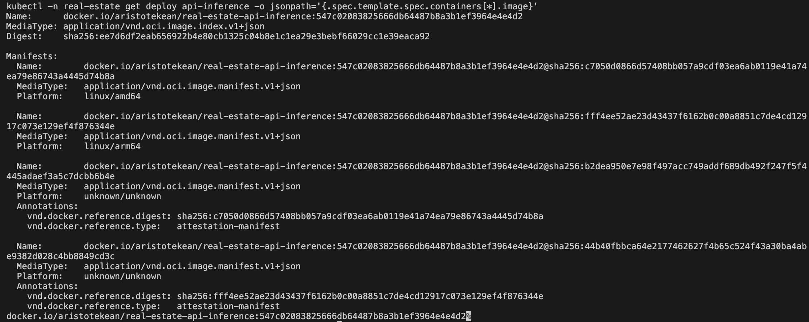

### 2. Argo CD

Application `real-estate` en *Healthy / Synced* contra `main` (`ea9922f`) con auto-sync activo. La vista de red muestra el Gateway `real-estate`, sus cuatro `HTTPRoute` (`airflow`, `api-inference`, `frontend`, `mlflow`) y los Services y pods a los que enrutan.

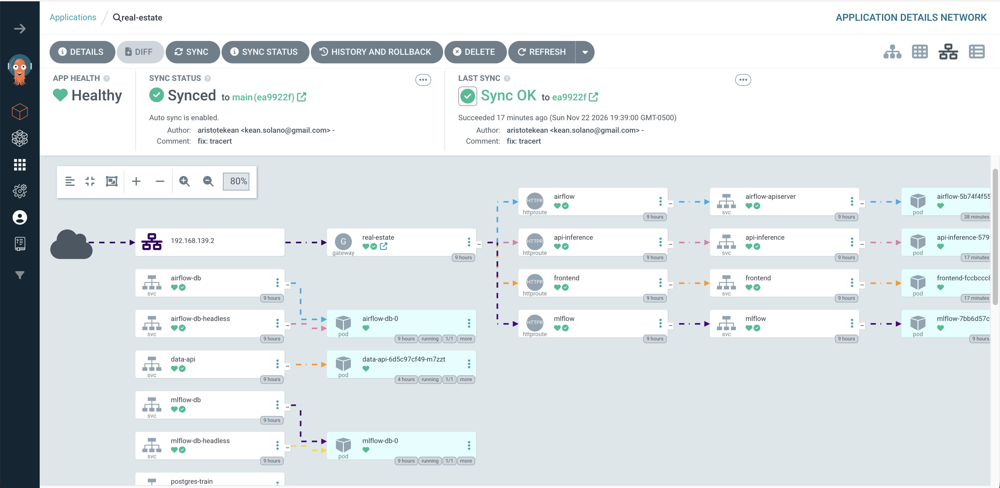

### 3. Clúster de Kubernetes

Pods del namespace `real-estate` en ejecución en OrbStack (`airflow`, `airflow-db`, `api-inference`, `data-api`, `frontend`, `mlflow`, `mlflow-db`, `postgres-train` y `rustfs`), junto con los de `argocd`.

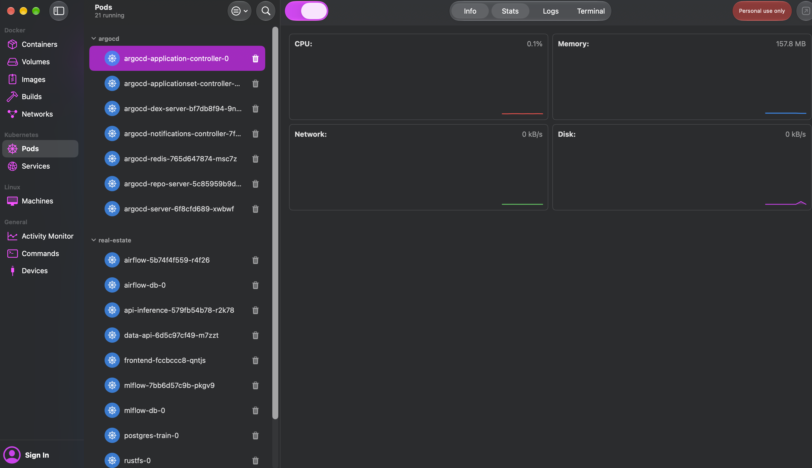

### 4. DAG en Airflow

Tres corridas programadas (`*/15 * * * *`) de `real_estate_incremental_training`, una por lote, sin tareas fallidas. Las tres recorren la rama `train_candidate_model` → `promote_model`; `no_new_batch`, `skip_training` y `reject_model` quedan omitidas.

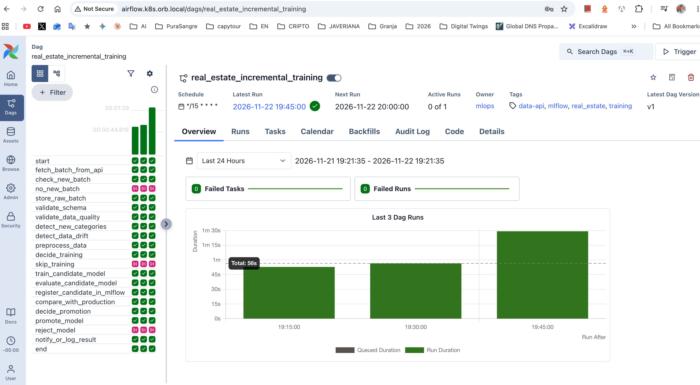

### 5. MLflow y almacén de artefactos

Experimento `real-estate-pricing` con un run por lote (`batch-0`, `batch-1` y `batch-2`), todos lanzados desde Airflow.

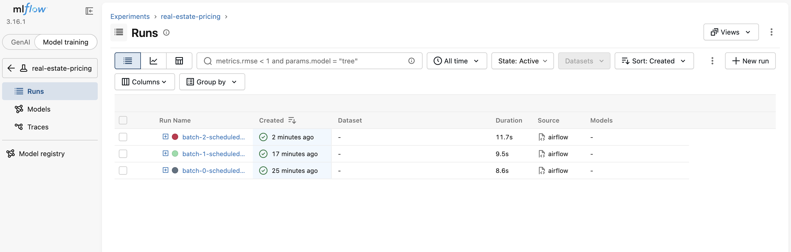

**Run del lote 2:** métricas del candidato, runs hijos (`hist_gradient_boosting`, `ridge`) y tags `batch_id`, `api_batch_number`, `clean_snapshot` y `training_reason`.

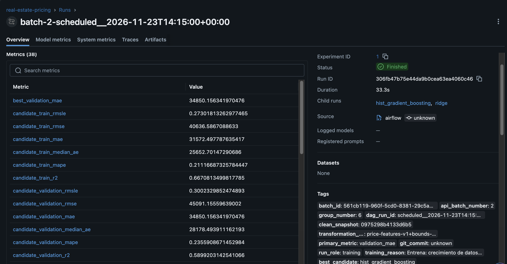

**Model Registry:** `real_estate` versión 3 con el alias `production`, entrenada con los lotes 0, 1 y 2 y con el motivo del entrenamiento.

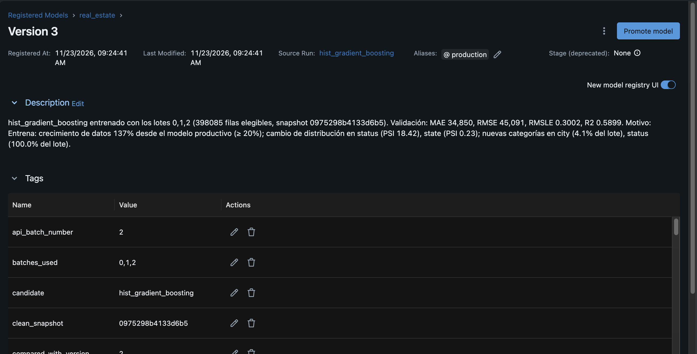

Artefactos de un modelo registrado en el bucket `mlflow` de RustFS: `MLmodel`, `model.skops`, el entorno (`conda.yaml`, `python_env.yaml`, `requirements.txt`), los ejemplos de entrada y `code/` con el paquete `real_estate_model`.

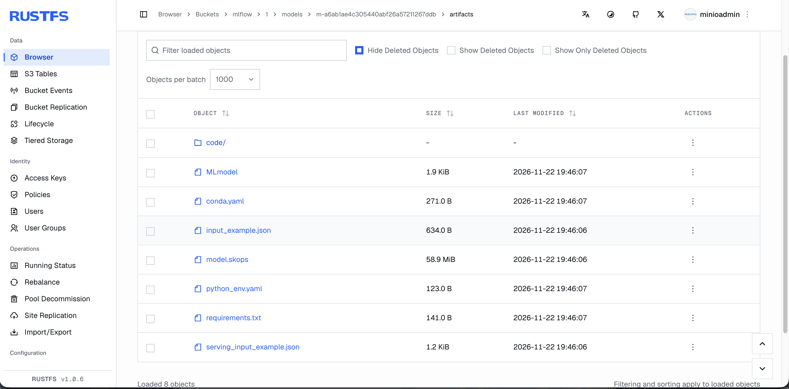

### 6. API de inferencia

`POST /predict` desde `api.k8s.orb.local/docs`: respuesta `200` con el precio estimado y el modelo `real_estate` versión 3 con el alias `production`.

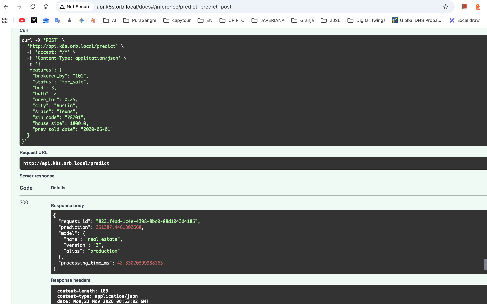

Filas de `inference.logs` en `postgres-train` con estado, código de error, versión del modelo, tiempo de procesamiento, predicción y `trace_id`. Se ven las peticiones rechazadas con `model_unavailable` antes de existir un modelo productivo y las predicciones servidas después por las versiones 1, 2 y 3.

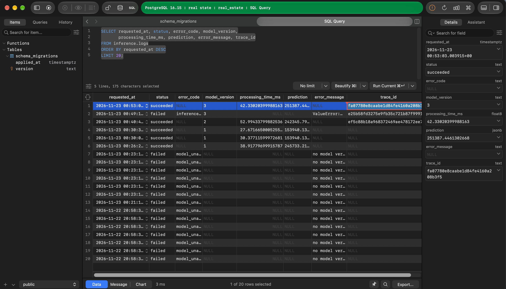

**Recarga sin redespliegue:** el mismo pod `api-inference-7466fc46fb-7ntnt` (0 reinicios) pasa de servir la versión 3 a la 4 tras la promoción.

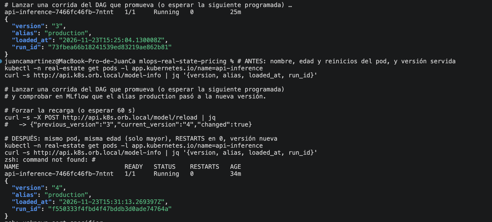

### 7. Frontend

Estimación de precio desde `frontend.k8s.orb.local` con el modelo `real_estate` versión 2 y el alias `production`; la barra lateral muestra la API disponible y el modelo cargado.

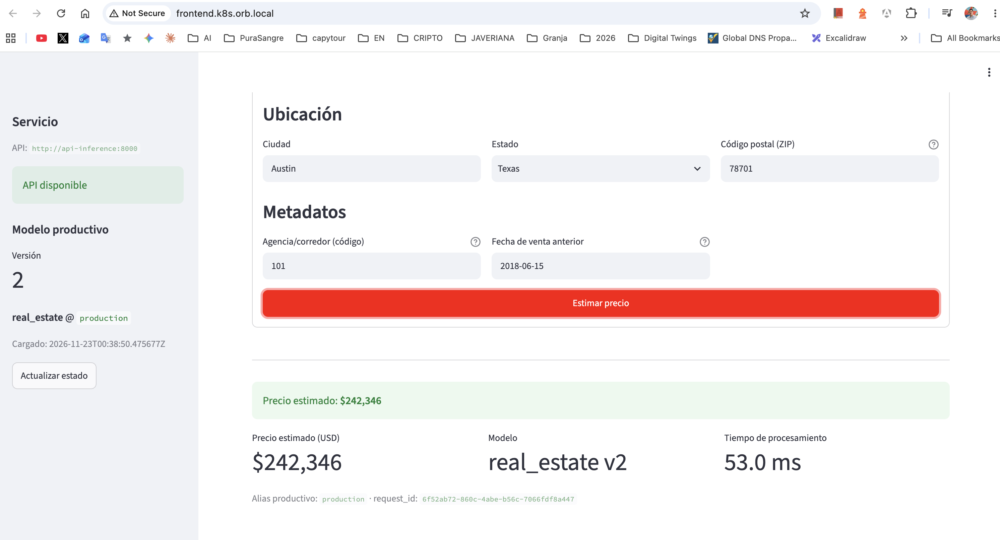

**Historial por lote:** decisión de entrenamiento, promoción y versión de cada lote. El lote 3 no entrenó; los demás entrenaron y se promovieron.

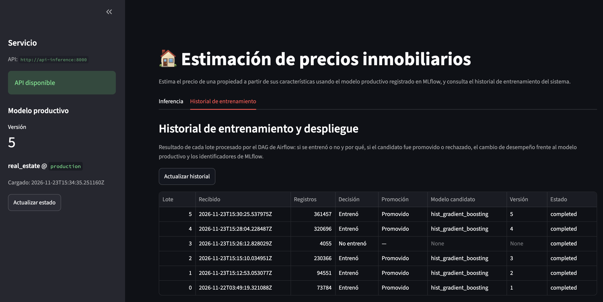

**Detalle del lote 2:** razones de entrenamiento y de promoción, cambio de versión productiva (2 → 3), deltas frente al productivo e identificadores de MLflow.

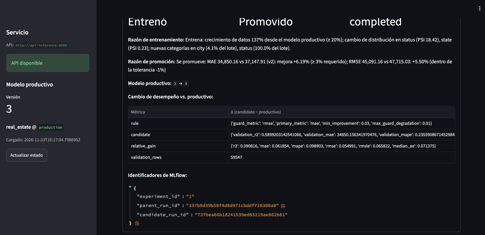

### 8. Observabilidad y prueba de carga

Tasa de peticiones a `/predict` por código de estado en Prometheus (`sum by (status) (rate(http_requests_total{path="/predict"}[5m]))`).

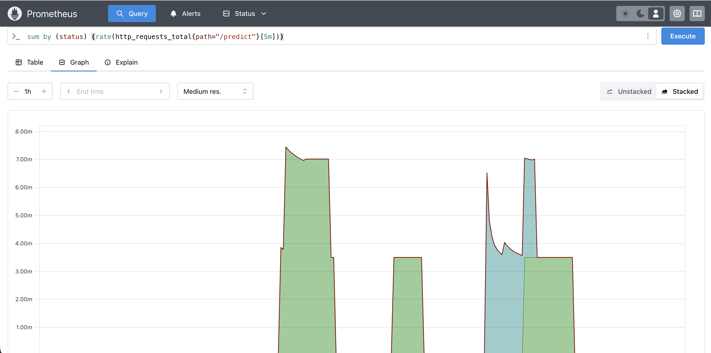

Dashboard de Grafana, fila **Tráfico HTTP**: solicitudes totales y por segundo, latencia promedio y por percentiles (p50 / p95 / p99), errores y solicitudes por código de estado.

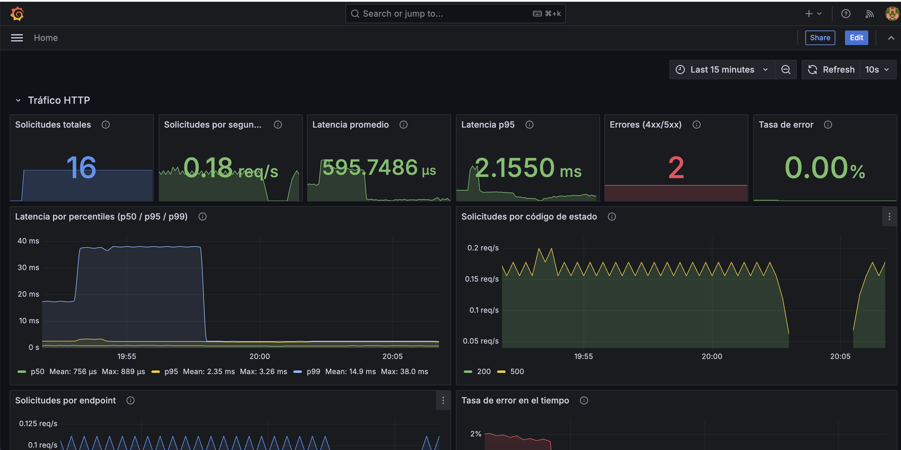

Traza distribuida en Jaeger: comienza en el frontend y continúa en api-inference (`POST /predict`), con los spans `model.predict` e `inference_log.write`. Su identificador (`ef5c88b1…`) es el `trace_id` de una de las filas de `inference.logs` del apartado 6.

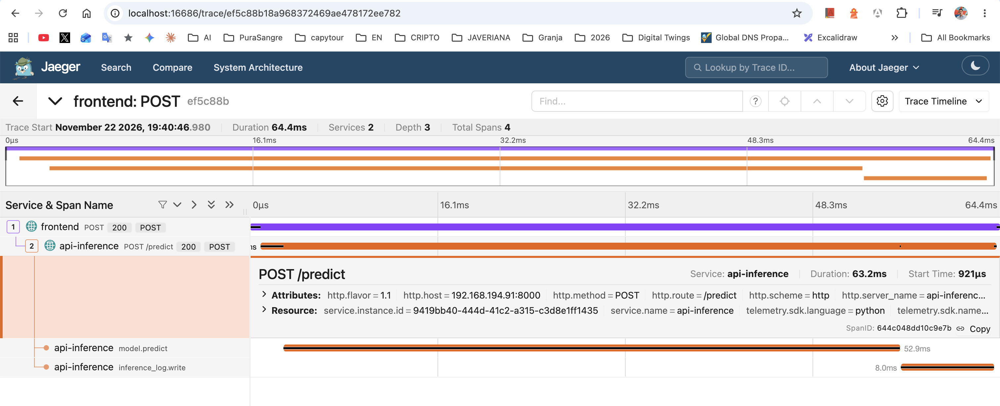

### 9. Repositorio

Contribuciones por integrante en GitHub (*Insights → Contributors*).

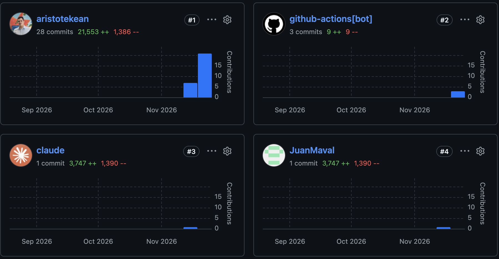
